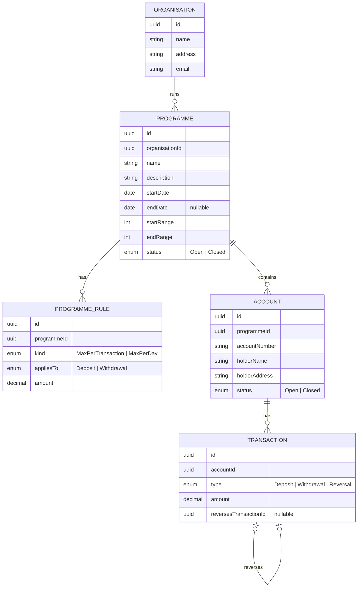

# Demo Banking Project

A small banking API built to practise languages: first C# / .NET, then Python, then Go.
All implementations follow the same spec: **[docs/requirements.md](docs/requirements.md)**.

| Implementation | Status |
|---|---|
| [C# / .NET](csharp/) | Stage 1 in progress |
| Python | Not started |
| Go | Not started |

## Entity Relationship Diagram

The `createdAt` / `updatedAt` timestamps are left out of the diagram. See the full ERD in the requirements doc.
