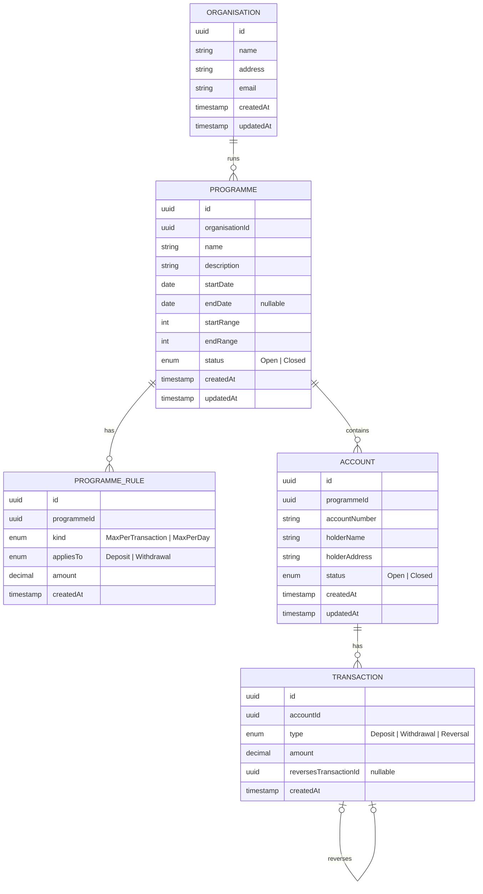

# Demo Banking — Requirements

This document is the **single source of truth** for every implementation (C#, then Python, then Go).
Each implementation must satisfy the API contract exactly, so that one black-box test suite can check all of them.
Requirement IDs (`ORG-1`, `TXN-4`, …) are stable. Reference them from test names and commits.

## 1. Purpose and scope

The point of this project is to **build fluency in a programming language**, not to build a bank.

- **Scope filter:** a feature is included only when it gives a natural reason to practise a modern language feature (see §8). When in doubt, choose the simplest version.
- **Actors:** back-office bank staff only. There are no customers, and there is no login.
- **Tenant:** an Organisation (a bank). Tenant isolation is deferred (§7, Stage 4). Routes are already nested under the organisation so isolation can be added without changing the contract.

**Non-goals:** authentication and authorisation (until Stage 4), customers as entities, transfers between accounts, interest, multiple currencies (everything is GBP and there is no currency field), pagination, fees, statements, notifications.

## 2. Domain

| Term | Meaning |
|---|---|
| **Organisation** | A bank. The tenant and top-level owner of everything else. |
| **Programme** | A savings product the bank runs, e.g. a long-running "Kids Saver" or a short "Easter Saver". It has an opening window and its own account number range. |
| **Programme Rule** | A limit on transactions for accounts in a programme, e.g. "max £20 per deposit". |
| **Account** | One holder's account in one programme. |
| **Transaction** | An append-only movement of money on an account: a Deposit (credit), a Withdrawal (debit) or a Reversal (correction). |
| **Balance** | The sum of an account's credits minus its debits. It is always derived and never stored. |



## 3. Cross-cutting rules

| ID | Requirement |
|---|---|
| GEN-1 | All IDs are UUIDv7 and generated by the server. |
| GEN-2 | Money is a decimal type in every language. Never use binary floating point, not even transiently while parsing JSON. Amounts are > 0 and have at most 2 decimal places. |
| GEN-3 | JSON uses camelCase property names, enums as strings (`"Deposit"`), dates as `YYYY-MM-DD` and timestamps as ISO 8601 UTC (`2026-11-09T14:03:00Z`). |
| GEN-4 | "Today" and "day" mean the **UTC** calendar date. The clock is injectable so tests can control time. |
| GEN-5 | Every entity has `createdAt`. Mutable entities also have `updatedAt`, which changes on every successful modification. |
| GEN-6 | Every error response is ProblemDetails (RFC 9457) with an extra `code` member (§6.2). |
| GEN-7 | List endpoints return a JSON array ordered by `createdAt` ascending. There is no pagination. |
| GEN-8 | A child requested under the wrong parent (e.g. an account ID under a different organisation) returns 404. |
| GEN-9 | Nothing that has history is ever hard-deleted. Hard DELETE works only on an entity with no children or transactions. Otherwise it returns 409 `has-dependents`. |

## 4. Entity requirements

### 4.1 Organisation

| ID | Requirement |
|---|---|
| ORG-1 | Fields: `name` (required, 1–100 chars), `address` (required, 1–200), `email` (required, valid email, ≤ 100). |
| ORG-2 | Create, read one, list all, and update (all fields replaced). |
| ORG-3 | Delete succeeds only if the organisation has no programmes. Otherwise 409 `has-dependents`. |

### 4.2 Programme

| ID | Requirement |
|---|---|
| PRG-1 | Fields: `name` (1–100), `description` (1–200), `startDate` (required date), `endDate` (optional date, ≥ `startDate`), `startRange` and `endRange` (integers, 1 ≤ startRange ≤ endRange ≤ 99,999,999). |
| PRG-2 | Within one organisation, programme ranges must not overlap. Otherwise 409 `range-overlap`. |
| PRG-3 | `startRange` and `endRange` can't be changed after creation. Update replaces `name`, `description`, `startDate` and `endDate`. |
| PRG-4 | `status` starts as `Open`. *Close* sets it to `Closed`, which is irreversible. Closing an already-closed programme returns 409 `already-closed`. |
| PRG-5 | The response includes a derived `acceptingNewAccounts`: `status == Open && startDate ≤ today && (endDate is null || today ≤ endDate)`. |
| PRG-6 | Existing accounts keep working normally after the programme closes or passes its end date. The window only controls **opening** accounts. |
| PRG-7 | Delete succeeds only if the programme has no accounts. Otherwise 409 `has-dependents`. Its rules are deleted with it. |

### 4.3 Programme Rule

| ID | Requirement |
|---|---|
| RUL-1 | Fields: `kind` (`MaxPerTransaction` \| `MaxPerDay`), `appliesTo` (`Deposit` \| `Withdrawal`), `amount` (money, > 0). |
| RUL-2 | A programme has at most one rule per (`kind`, `appliesTo`). A duplicate returns 409 `duplicate-rule`. To change a limit, delete the rule and create a new one. |
| RUL-3 | `MaxPerTransaction`: a Deposit/Withdrawal whose `amount` is greater than the limit is rejected with 422 `limit-exceeded`. |
| RUL-4 | `MaxPerDay`: the request is rejected with 422 `limit-exceeded` if (the sum of today's transactions of that type on the account + the new amount) is greater than the limit. Already-reversed transactions still count toward the total. |
| RUL-5 | Rules apply to Deposits and Withdrawals only. Reversals are corrections and are **never** limited. |
| RUL-6 | Rules take effect from the moment they're created. Earlier transactions are not re-checked. |
| RUL-7 | The design must make it easy to add new rule kinds (e.g. a minimum balance). Adding one must not require changes to existing rule kinds. |

### 4.4 Account

| ID | Requirement |
|---|---|
| ACC-1 | Fields supplied by the client: `holderName` (1–100) and `holderAddress` (1–200). |
| ACC-2 | The server assigns `accountNumber`: the lowest number in the programme's range not yet used, formatted as an 8-digit zero-padded string (`"00010001"`). The client never supplies it. |
| ACC-3 | If the range is full, the request returns 409 `range-exhausted`. |
| ACC-4 | Concurrent account creation must never assign the same number twice. |
| ACC-5 | An account can only be opened when the programme's `acceptingNewAccounts` is true. Otherwise 422 `programme-not-accepting`. |
| ACC-6 | An account opens with `status = Open` and a balance of 0. There is no opening deposit. |
| ACC-7 | Update replaces `holderName` and `holderAddress`. The account number never changes. |
| ACC-8 | *Close* sets `status = Closed`, which is irreversible. If the balance isn't 0 it returns 422 `balance-not-zero`. If the account is already closed it returns 409 `already-closed`. |
| ACC-9 | A closed account accepts no transactions (409 `account-closed`) and no updates (409 `account-closed`). |
| ACC-10 | The account response includes the derived `balance`. |
| ACC-11 | Delete succeeds only if the account has no transactions. Otherwise 409 `has-dependents`. |

### 4.5 Transaction

| ID | Requirement |
|---|---|
| TXN-1 | Transactions are append-only. There is no update or delete endpoint. |
| TXN-2 | A **Deposit** credits `amount`. A **Withdrawal** debits `amount`. |
| TXN-3 | A Withdrawal that would make the balance negative returns 422 `insufficient-funds`. |
| TXN-4 | A **Reversal** is created against an existing Deposit or Withdrawal. It has the same `amount`, the opposite direction, and `reversesTransactionId` set to the original. |
| TXN-5 | A transaction can be reversed at most once (409 `already-reversed`). A Reversal itself can't be reversed (409 `cannot-reverse-reversal`). |
| TXN-6 | Reversing a Deposit is still a debit, so it can't make the balance negative (422 `insufficient-funds`). |
| TXN-7 | `balance = Σ(Deposit) − Σ(Withdrawal) + Σ(Reversal of Withdrawal) − Σ(Reversal of Deposit)`. |
| TXN-8 | Concurrent transactions on one account must never produce a negative balance or break a `MaxPerDay` limit. |
| TXN-9 | Validation runs in this order, and the first failure wins: request validation (400) → account exists (404) → account open (409) → rule limits (422) → sufficient funds (422). |
| TXN-10 | The transaction response includes `direction` (`Credit` \| `Debit`) and a derived `reversedByTransactionId` (null if not reversed). |

## 5. API contract

Base path: `/`. All bodies are `application/json`. Errors are `application/problem+json`.

Shorthand: `{org}` = `/organisations/{organisationId}`, `{prg}` = `{org}/programmes/{programmeId}`, `{acc}` = `{org}/accounts/{accountId}`.

### 5.1 Routes

| Method | Path | Request | Success | Errors |
|---|---|---|---|---|
| POST | `/organisations` | OrganisationRequest | 201 Organisation, `Location` header | 400 |
| GET | `/organisations` | – | 200 Organisation[] | – |
| GET | `{org}` | – | 200 Organisation | 404 |
| PUT | `{org}` | OrganisationRequest | 200 Organisation | 400, 404 |
| DELETE | `{org}` | – | 204 | 404, 409 has-dependents |
| POST | `{org}/programmes` | CreateProgrammeRequest | 201 Programme | 400, 404, 409 range-overlap |
| GET | `{org}/programmes` | – | 200 Programme[] | 404 |
| GET | `{prg}` | – | 200 Programme | 404 |
| PUT | `{prg}` | UpdateProgrammeRequest | 200 Programme | 400, 404 |
| POST | `{prg}/close` | – | 200 Programme | 404, 409 already-closed |
| DELETE | `{prg}` | – | 204 | 404, 409 has-dependents |
| POST | `{prg}/rules` | RuleRequest | 201 Rule | 400, 404, 409 duplicate-rule |
| GET | `{prg}/rules` | – | 200 Rule[] | 404 |
| DELETE | `{prg}/rules/{ruleId}` | – | 204 | 404 |
| POST | `{prg}/accounts` | AccountRequest | 201 Account | 400, 404, 409 range-exhausted, 422 programme-not-accepting |
| GET | `{prg}/accounts` | – | 200 Account[] | 404 |
| GET | `{acc}` | – | 200 Account | 404 |
| PUT | `{acc}` | AccountRequest | 200 Account | 400, 404, 409 account-closed |
| POST | `{acc}/close` | – | 200 Account | 404, 409 already-closed, 422 balance-not-zero |
| DELETE | `{acc}` | – | 204 | 404, 409 has-dependents |
| POST | `{acc}/transactions` | TransactionRequest | 201 Transaction | 400, 404, 409 account-closed, 422 limit-exceeded / insufficient-funds |
| GET | `{acc}/transactions` | – | 200 Transaction[] | 404 |
| GET | `{acc}/transactions/{transactionId}` | – | 200 Transaction | 404 |
| POST | `{acc}/transactions/{transactionId}/reverse` | – | 201 Transaction (the Reversal) | 404, 409 account-closed / already-reversed / cannot-reverse-reversal, 422 insufficient-funds |

Accounts are created and listed under their programme, but addressed under the organisation (`{acc}`), because an account ID is unique on its own.

Every 201 response includes a `Location` header pointing at the new resource.

### 5.2 Payloads

```jsonc
// OrganisationRequest
{ "name": "Acme Bank", "address": "1 High St", "email": "ops@acme.example" }

// Organisation
{ "id": "019a…", "name": "Acme Bank", "address": "1 High St", "email": "ops@acme.example",
  "createdAt": "2026-11-09T10:00:00Z", "updatedAt": "2026-11-09T10:00:00Z" }

// CreateProgrammeRequest
{ "name": "Easter Saver", "description": "Limited issue", "startDate": "2027-03-01",
  "endDate": "2027-04-30", "startRange": 10000000, "endRange": 10009999 }

// UpdateProgrammeRequest
{ "name": "Easter Saver", "description": "Limited issue", "startDate": "2027-03-01", "endDate": null }

// Programme
{ "id": "019a…", "organisationId": "019a…", "name": "Easter Saver", "description": "Limited issue",
  "startDate": "2027-03-01", "endDate": "2027-04-30", "startRange": 10000000, "endRange": 10009999,
  "status": "Open", "acceptingNewAccounts": false,
  "createdAt": "…", "updatedAt": "…" }

// RuleRequest
{ "kind": "MaxPerDay", "appliesTo": "Deposit", "amount": 200.00 }

// Rule
{ "id": "019a…", "programmeId": "019a…", "kind": "MaxPerDay", "appliesTo": "Deposit",
  "amount": 200.00, "createdAt": "…" }

// AccountRequest
{ "holderName": "Sam Smith", "holderAddress": "2 Low Rd" }

// Account
{ "id": "019a…", "programmeId": "019a…", "accountNumber": "10000000", "holderName": "Sam Smith",
  "holderAddress": "2 Low Rd", "status": "Open", "balance": 0.00,
  "createdAt": "…", "updatedAt": "…" }

// TransactionRequest  (type is Deposit or Withdrawal; Reversal has its own route)
{ "type": "Deposit", "amount": 20.00 }

// Transaction
{ "id": "019a…", "accountId": "019a…", "type": "Deposit", "direction": "Credit", "amount": 20.00,
  "reversesTransactionId": null, "reversedByTransactionId": null, "createdAt": "…" }
```

## 6. Errors

### 6.1 Status code meaning

| Status | Meaning |
|---|---|
| 400 | The request is malformed or fails field validation. |
| 404 | The resource (or its parent) doesn't exist. |
| 409 | The request conflicts with the resource's current state or a uniqueness rule. |
| 422 | The request is valid, but a business rule refuses it (money, limits, opening window). |

### 6.2 ProblemDetails shape

```jsonc
// Business rule error
{ "type": "about:blank", "title": "Insufficient funds", "status": 422,
  "detail": "Withdrawal of 50.00 exceeds balance of 30.00.", "code": "insufficient-funds" }

// Validation error (400): adds "errors", keyed by camelCase field name
{ "type": "about:blank", "title": "Validation failed", "status": 400, "code": "validation-failed",
  "errors": { "email": ["Email is not valid."], "name": ["Name is required."] } }
```

Tests assert on `status`, `code` and the keys of `errors`. They never assert on `title`, `detail` or message text.

### 6.3 Codes

`validation-failed`, `not-found`, `has-dependents`, `range-overlap`, `already-closed`, `duplicate-rule`,
`range-exhausted`, `programme-not-accepting`, `account-closed`, `balance-not-zero`, `limit-exceeded`,
`insufficient-funds`, `already-reversed`, `cannot-reverse-reversal`.

## 7. Roadmap

Each stage is complete when its requirements pass in the shared acceptance suite.

| Stage | Contents | Requirements |
|---|---|---|
| 1 | CRUD and lifecycle for Organisation, Programme and Account; ProblemDetails; account number allocation | GEN-*, ORG-*, PRG-*, ACC-* (ACC-8, ACC-10 return a balance of 0 until Stage 2) |
| 2 | Deposits, withdrawals, reversals, derived balance, concurrency safety | TXN-* |
| 3 | Programme rules | RUL-* |
| 4 (optional) | Tenancy and auth: staff belong to one organisation and see only its data | to be written |

Later, outside the language implementations:
- A shared `docs/openapi.yaml` describing §5.
- A language-agnostic black-box acceptance suite that runs against any implementation's base URL.
- (Maybe) a double-entry ledger, only if it earns its place under the §1 scope filter.

## 8. Language features exercised

What each feature is *for*, learning-wise.

| Feature | C# | Python | Go |
|---|---|---|---|
| Request/response DTOs | `record`, `required` members | `pydantic` models / `@dataclass(frozen=True)` | structs with `json` tags |
| Enums as JSON strings | `enum` + `JsonStringEnumConverter` | `StrEnum` | typed string constants |
| Money | `decimal` | `decimal.Decimal`, parsing JSON without float | no built-in decimal; integer pence or a decimal library (a deliberate trade-off to learn from) |
| Dates and "today" | `DateOnly`, `TimeProvider` / `FakeTimeProvider` | `datetime.date`, an injected clock | `time.Time`, a `Clock` interface |
| Rule kinds (RUL-7) | abstract record hierarchy + `switch` expression / pattern matching | `match` statement over dataclasses | interface + type switch |
| Lifecycle (Open → Closed) | encapsulated entities (private setters, guard methods) | properties and methods that raise domain errors | methods returning `error` |
| Errors → ProblemDetails | `TypedResults`, `IExceptionHandler` or Result types | exception handlers in FastAPI | `errors.Is` / `errors.As`, wrapped errors |
| Nested routes | `MapGroup` | `APIRouter` with prefixes | Go 1.22 `ServeMux` path patterns |
| Account number format | format strings `{n:D8}` | f-strings `f"{n:08d}"` | `fmt.Sprintf("%08d", n)` |
| Derived balance and daily totals | LINQ / EF projections | comprehensions, `sum()` | loops, `slices` package, generics |
| Concurrency (ACC-4, TXN-8) | DB transactions, row locks or concurrency tokens in EF Core | SQLAlchemy transactions / `async` | `database/sql` `Tx`, `context.Context` |
| Testing | xUnit, `WebApplicationFactory`, Testcontainers | pytest, fixtures, `httpx` | `testing`, `httptest`, table-driven tests |

## 9. Current C# implementation vs this spec

A checklist of gaps found on 2026-11-09. These are for the developer to fix; work through them test-first.

- [ ] Routes are flat (`/programmes`, `/accounts`) and need to be nested (§5.1).
- [ ] Errors return raw FluentValidation failures, not ProblemDetails with `code` (GEN-6).
- [ ] `DELETE /organisations/{id}` returns 204 for a missing organisation (should be 404) and 500 when programmes exist (should be 409, ORG-3).
- [ ] `PUT /organisations/{id}` returns 200 with no body. It should return the Organisation (§5.1).
- [ ] The `DeleteOrganisation_ReturnsNotFound` test uses an invalid GUID, so it passes because of the route constraint, not the code under test.
- [ ] Programme dates are `DateTimeOffset`. They should be date-only with an optional `endDate` (PRG-1).
- [ ] `ProgrammeConfiguration` marks `StartRange` (and others) as value-generated, and the migration made `StartRange` an identity column.
- [ ] Programme `status`, `acceptingNewAccounts`, range-overlap check, close and update are missing (PRG-2..5).
- [ ] `CreateProgrammeDtoValidator` doesn't validate dates or ranges (PRG-1).
- [ ] Listing programmes ignores `organisationId`.
- [ ] Account: no status, no number allocation, doesn't use `EntityBase`, and the service is unimplemented (ACC-*).
- [ ] ProgrammeRule and Transaction don't exist yet (Stages 2–3).
- [ ] Integration tests run against the shared dev database. Use an isolated database (e.g. Testcontainers).
